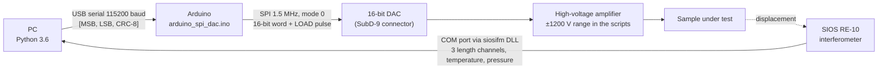

<div align="center">

# Piezo Setup

**Lab integration code (2019) for driving a high-voltage amplifier from an Arduino 16-bit SPI DAC and reading a SIOS RE-10 interferometer from Python, MATLAB and C++.**

[](https://www.python.org/)
[](https://www.arduino.cc/)
[](https://www.mathworks.com/products/matlab.html)
[](https://isocpp.org/)
[](#-requirements)
[](#-known-issues)

</div>

> [!NOTE]
> Written in July–August 2019 at the University of Groningen, during the PhD project that led to the thesis [*Multi-loop Hysteresis and Recursive Remnant Control*](https://doi.org/10.33612/diss.215199709). It talks to specific lab hardware and is kept as a reference.

## 📑 Contents

- [Signal chain](#-signal-chain)
- [Repository layout](#-repository-layout)
- [Serial protocol](#-serial-protocol)
- [Requirements](#-requirements)
- [Setup](#-setup)
- [Running](#-running)
- [Known issues](#-known-issues)
- [Third-party software](#-third-party-software)

## 🔌 Signal chain



`python_integration/measurement_loop.py` closes this chain: for every interferometer sample it sends the next voltage of a characterization signal and logs `(init_amp, pulse_amp, idx, time, voltage, deformation)` to a CSV file.

## 🗂️ Repository layout

| Path | Contents |
|:---|:---|
| `arduino_spi_dac/` | Firmware: receives 3-byte frames, checks the CRC, writes the value to the DAC over SPI (LOAD → pin 10, SDI → pin 11, CLK → pin 13) |
| `python_integration/` | Latest code: `AmplifierController`, `InterferometerController` (each in its own process), `measurement_loop.py`, `control_loop_simple.py`, `plot_measurement_loop.py` |
| `python_serial/` | First serial sender with a threaded and a single-shot variant |
| `python_interferometer/` | First interferometer reader built on the vendor Python example |
| `python_matlab/` | Smoke test for the MATLAB Engine API for Python (`matlab.engine.connect_matlab`) |
| `matlab_interferometer_example/` | Interferometer read-out from MATLAB through `loadlibrary` |
| `cpp_interferometer_example_3/`, `_4/` | Vendor C++ examples adapted for a COM port, with VS Code build tasks |
| `commons/` | SIOS headers and import files used by all of the above |
| `siosifm_dev_win32/`, `siosifm_dev_win32.zip` | SIOS development pack for the RE-10 interferometer |
| `readme.docx` | Original setup notes (summarised under [Setup](#-setup)) |

## 📡 Serial protocol

| Byte | Content |
|:---:|:---|
| 0 | DAC value, most significant byte |
| 1 | DAC value, least significant byte |
| 2 | CRC-8/MAXIM (reflected polynomial `0x8C`) of bytes 0–1 |

Voltages map linearly onto the 16-bit range, with `0x8000` at 0 V:

```python
value_dac = round((-value / (v_max - v_min) + 0.5) * 0xFFFF)   # python_integration/amplifier_utils.py
```

On power-up the firmware writes `0x8000`. Frames with a wrong CRC are ignored.

## 🧰 Requirements

| Requirement | Used by |
|:---|:---|
| Windows (COM ports, `msvcrt`, Windows DLLs) | everything on the PC side |
| Python 3.6 (Anaconda environment `py36`) with `pyserial`, `numpy`, `matplotlib` | `python_*` |
| Arduino IDE with the `SPI` library | `arduino_spi_dac/` |
| MATLAB with a MinGW-w64 C compiler for `loadlibrary`, and the MATLAB Engine API for Python | `matlab_interferometer_example/`, `python_matlab/` |
| MinGW-w64 `gcc`/`gdb` (win-builds) | `cpp_interferometer_example_*` |
| SIOS RE-10 interferometer, Arduino with a 16-bit SPI DAC, high-voltage amplifier | hardware |

## 🛠️ Setup

From `readme.docx`:

1. **MATLAB:** install MinGW-w64 (x86_64) with win-builds, set `MW_MINGW64_LOC` to its root folder, add the root and `bin` folders to `PATH`, then run `mex -setup c -v` and `mex -setup c++ -v`.
2. **Python:**
   ```bat
   conda create -n py36 python=3.6 anaconda
   conda activate py36
   cd "matlabroot\extern\engines\python"
   python setup.py install
   ```
3. In MATLAB, run `matlab.engine.shareEngine` so Python can attach to the running session.

Then:

4. Extract `64bit/siosifm64.dll` from `siosifm_dev_win32.zip` into `commons/64bit/` — every Python, MATLAB and C++ loader expects it there and it is not tracked outside the zip.
5. Flash `arduino_spi_dac/arduino_spi_dac.ino`.
6. Edit the COM ports in the script you want to run (see [Known issues](#-known-issues)).

## ▶️ Running

Run each script from its own folder; the DLL path `../commons/64bit/` and the imports are relative.

```bat
cd python_integration
python amplifier_single_send.py        :: type a voltage, Ctrl+C sends 0 V and exits
python interferometer_utils_test.py    :: first key press starts measuring, second stops
python measurement_loop.py             :: key press starts the sweep, writes measurement-loop-<timestamp>.csv
python plot_measurement_loop.py        :: set the CSV file name on line 4 first
```

`measurement_loop.py` sweeps an initial amplitude of 1200 V with pulse amplitudes from 100 to 1200 V in steps of 100 V.

## ⚠️ Known issues

| Issue | Where |
|:---|:---|
| COM ports are hard-coded and differ between scripts (`COM4`, `COM5`, `COM6`, interferometer ports 4–7) | every script |
| `siosifm64.dll` exists only inside the zip | `commons/64bit/` |
| The firmware never sends data back, so the read-back in the first sender waits for its timeout | `python_serial/amplifier_utils.py:79` |
| The newer code inverts the voltage sign; the first sender does not | `python_integration/amplifier_utils.py:56` vs `python_serial/amplifier_utils.py:70` |
| `inspect.getargspec` was removed in Python 3.11 | `python_integration/amplifier_utils.py` |
| The plot script reads a fixed CSV name; CSV files are ignored by git | `python_integration/plot_measurement_loop.py:4` |

## 📦 Third-party software

`siosifm_dev_win32/`, `siosifm_dev_win32.zip`, `commons/` and the `siosifm.py` bindings are part of the siosifm development pack by SIOS Meßtechnik GmbH (API description version 1.7, 2016). The C++, MATLAB and Python interferometer examples are adapted from that pack. The pack does not include a license statement, and this repository does not include a license file.

---

<div align="center">
<sub>Part of <a href="https://github.com/mavasbel-research">mavasbel-research</a> · <a href="https://github.com/mavasbel">Marco Vásquez Beltrán</a></sub>
</div>
